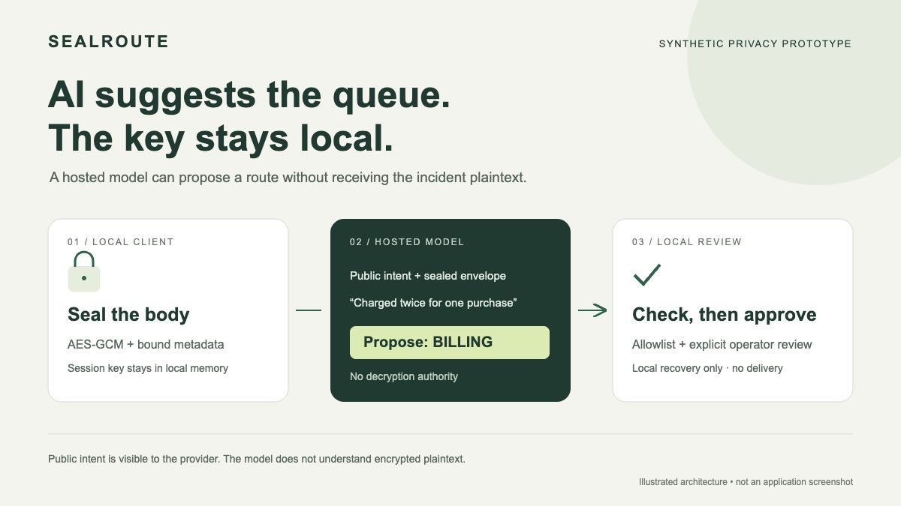

# SealRoute



Public source: https://github.com/estona815/sealroute-mathsecurity-2026

A synthetic incident desk that separates an AI's routing suggestion from access to a private incident body. The local client encrypts the body, sends an opaque envelope and deliberately public intent to a hosted LLM, validates a proposed queue against local authority, and asks an operator before local review. It never delivers an incident or executes model commands.

This is a local prototype for the **AI pipeline** track of Mathematics for systems security, not a novel cryptographic algorithm, FHE system, production helpdesk or security certification. No Devpost registration/submission or public deployment is established by these source files.

## Run

Python 3.9+ and `cryptography` are required (`python3 -m pip install cryptography==48.0.1` in a separate environment if needed). The tested environment is Python 3.9.6 with cryptography 48.0.1; no dependency or model was downloaded for this experiment. Upstream cryptography offers Apache-2.0 OR BSD-3-Clause licensing. Python's standard library handles the API transport and terminal UI.

```sh
python3 -m unittest -v
python3 demo.py --fixture access --report-dir /a/new/empty/run-directory
```

The output directory must not exist. Every invocation writes an intent and a bounded outbound packet; it refuses to overwrite or reuse a run. The ordinary command uses an explicitly labeled deterministic fixture, **not inference**. With an interactive terminal, type the proposed queue label to approve local review of a fictional body, or press Enter to cancel. Noninteractive runs always stop before approval and decryption. No delivery occurs in either mode.

For one real network experiment, add `--live`. This sends only the selected built-in fictional fixture, encrypted body and public intent to a community Space's documented Gradio API. The model is `Qwen/Qwen3-4B-Instruct-2507`, using the **unauthenticated ZeroGPU daily quota**, with 64 maximum new tokens and temperature 0.1. No model is downloaded locally.

The HTTP client constructs a fresh opener with no account, cookies or authorization header and a fixed public endpoint. Hugging Face's official ZeroGPU documentation lists 2 minutes/day for unauthenticated users. Paid-tier quota extension can consume prepaid credits, so this client does not connect an account, offer login, accept a key or fall back to paid inference. Quota errors stop the run. The quota is shared/limited and service availability is not guaranteed; this is not perpetual free hosting or an SLA. Check current terms and limits before live use.

The report directory must be new. An exclusive intent is saved before the single POST, followed by the returned event ID before result polling. After uncertainty, inspect `submitted.json` and the original event; do not run another POST to guess the result. A provider error is recorded as an error. There is no automatic retry, authentication, deployment or paid fallback.

## Disclosure boundary

| Stays in local session memory | Sent to hosted model |
| --- | --- |
| Random 256-bit session key, fictional incident body, consumed IDs | Public intent, queue labels/meanings, random envelope ID, nonce, ciphertext/tag |

The provider can infer length, timing and the topic of the **public** intent. It cannot be asked to understand an AES-encrypted body. Do not put confidential facts into public intent. The shipped demo accepts no custom incident files or credentials. A plaintext-to-LLM baseline is a disclosure contrast, not an experimentally measured breach rate.

AES-GCM encrypts each body with a fresh 96-bit random nonce, checked for uniqueness within the session. Canonical public metadata is authenticated as AAD, binding the ID, intent, version and authorized queues. Ciphertext/tag, nonce, metadata or key mismatches fail authentication. Keys are newly generated for each process and not written in reports. Reports include the exact synthetic outbound packet, response and local state; no body/key export is provided. `outbound_sha256` fingerprints the canonical JSON body sent by the adapter; it does not fingerprint TLS packets.

Model text must be one exact authorized label (surrounding whitespace allowed). Prose, JSON, code blocks, unknown labels, multiple labels, long output and command text fail closed. An allowed label is still only a proposal: **authorization is not semantic correctness**. A wrong but allowed label requires operator rejection. Local review consumes the envelope once per in-memory session, after authentication. This is not persistent distributed replay protection.

## Observed QA, 2026-10-21

An earlier CPU experiment with SmolLM2 135M produced invalid repeated text, correctly rejected. SmolLM2 1.7B returned a correct ACCESS proposal for account recovery but repeatedly misrouted billing requests to ACCESS. Those results remain preserved; they were not edited into successes.

A materially different provider/model was then tested: Qwen3 4B through a public ZeroGPU API. A single batch of six differently worded synthetic requests returned the six expected queue labels in order. A separate integrated live terminal run correctly proposed BILLING for a duplicate-charge request; explicit local approval recovered only the fictional body and recorded no delivery. The six-case batch is a designed scenario check, not a held-out benchmark or a general accuracy claim.

Thirteen offline tests cover authenticated tamper rejection, wrong keys, metadata binding, private-material exclusion, authority and approval boundaries, session replay, bounds, the observed named HTTP API contract, terminal result/error parsing and no automatic resubmit. The original offline terminal approval/cancellation exercises remain separate from the later live success.

The model-utility gate has now passed these bounded synthetic scenarios. Contest registration, public submission, judge acceptance, a production deployment and real-user reliability remain separate facts. Review the small exact outbound packets and raw result records in `evidence/` before interpreting any broader claims.

## Threats and limits

- Untrusted model output cannot name a new destination, alter local ciphertext, call a shell, decrypt, or perform an outbound incident delivery: those capabilities are absent from the adapter.
- AES-GCM authenticity is not an instruction-following guarantee. Public intent may contain misleading instructions; local allowlists limit authority while human review checks meaning.
- No claim of constant-time application logic, secure erasure, enclave protection, network anonymity or protection after local machine compromise. Python process memory contains the key and recovered body.
- The host sees intentionally disclosed metadata and can deny service, retain ciphertext or return incorrect answers. There is no host retention audit.
- Cross-session recovery, recipient key exchange, audit signing, persistent replay control, real-user testing and deployment are out of scope.

## Sources and provenance

Codex authored this prototype and synthetic fixtures with AI assistance; no claim of unaided participant authorship or participant understanding is made. No MaskPatch code was copied: MaskPatch performs local token-span suggestions and reversible text edits; SealRoute uses authenticated encryption, hosted semantic routing over public intent and a local capability boundary. Similar privacy themes alone do not establish reused contest artifacts.

- Rules: https://mathematics-systems-security.devpost.com/rules — video optional; AI track favors UI and evidence of hosted API use. Choosing to omit video forgoes its optional points. Six noncash prizes, no monetary-prize claim.
- Overview: https://mathematics-systems-security.devpost.com/ — AI track allows existing cryptography and Python; local website or TUI suggested. Do not apply the cryptographer track's originality requirement to AES in the AI track.
- Resources: https://mathematics-systems-security.devpost.com/resources — mentions corporate LLMs including Hugging Face. A community Space is an HF-hosted deployment of an HF model; interpretation of the organizer's provider wording is not guaranteed by this experiment.
- API owner/source: https://huggingface.co/spaces/Zacheus10/free-ai-chat/commit/1e2fae906fa4f1c876aa9202cfefa590c3a3102c — source inspected, not copied or executed locally. Current API contract was verified through the app's Use via API panel.
- Model card/license: https://huggingface.co/Qwen/Qwen3-4B-Instruct-2507 — model hosted remotely, not redistributed here.
- API docs: https://huggingface.co/docs/hub/spaces-api-endpoints
- Anonymous quota and paid-tier distinction: https://huggingface.co/docs/hub/spaces-zerogpu
- Cryptography semantics: https://cryptography.io/en/latest/hazmat/primitives/aead/ — nonce uniqueness and AAD authentication.
- Cryptography license: https://github.com/pyca/cryptography/blob/main/LICENSE

The submission deadline observed in the signed-in Devpost header is 2026-11-01 23:00 KST. The rules table lists gallery opening after the winner-announcement date; preserve that conflict rather than inventing a corrected schedule.
